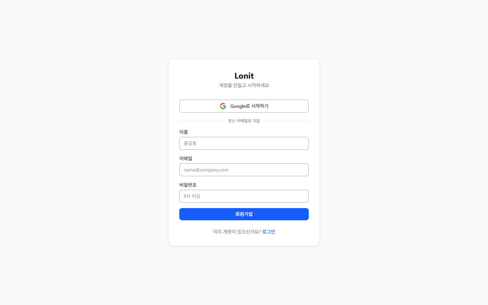
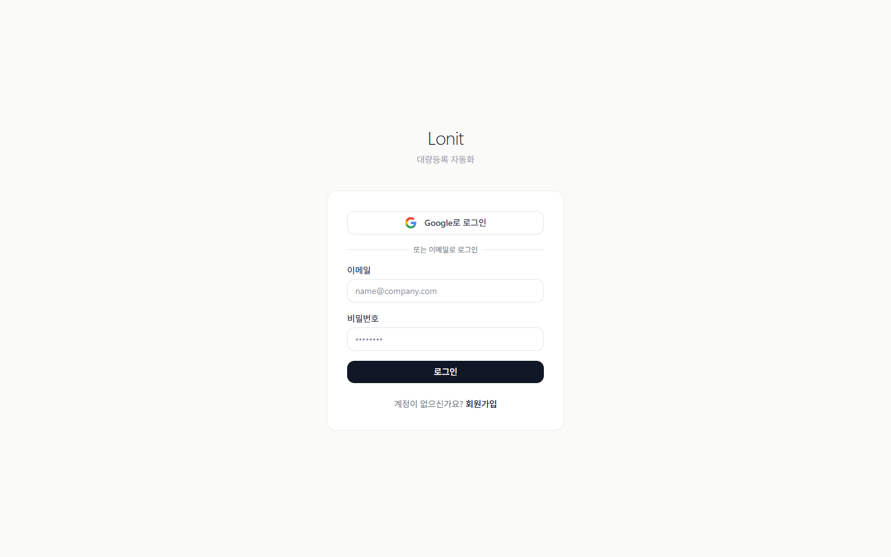
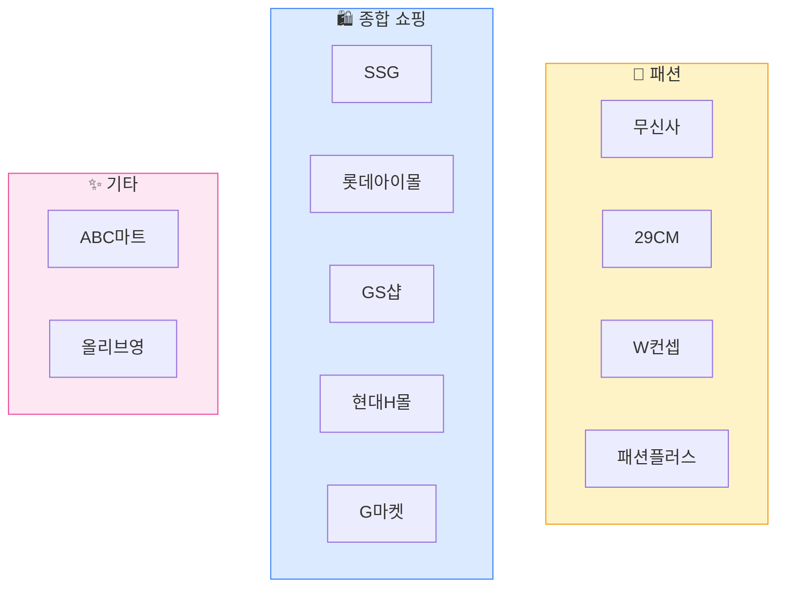
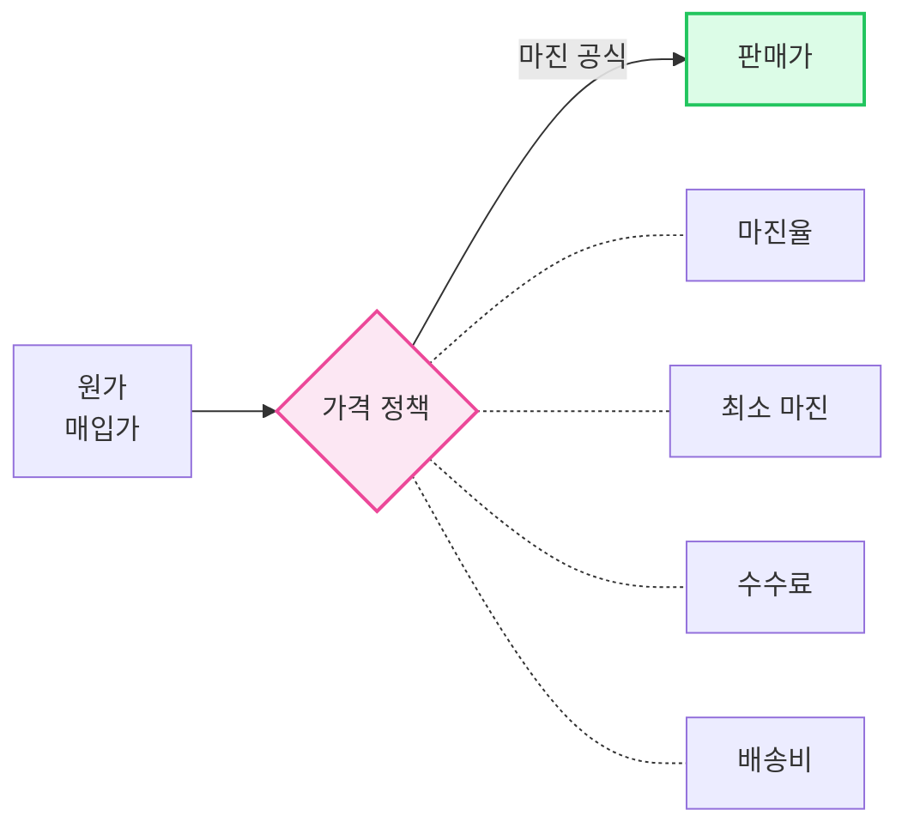
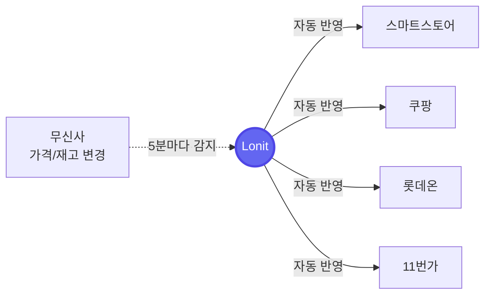

# 5분 빠른 시작

처음 시작하는 분은 아래 순서로 진행하세요. 첫 상품 하나를 원하는 마켓의 판매자 계정에 올리는 과정입니다.

[회원가입](#signup) → [마켓 계정 연결](#market-account) → [확장 프로그램 설치](#extension) → [가격 정책 설정](#policy) → [상품 하나 수집](#collect) → [첫 상품 등록](#first-upload)

---

## 1. 회원가입

[로닛 회원가입](https://www.lonit.kr/signup)에서 **Google로 시작하기**를 선택하거나 이름·이메일·비밀번호를 입력하고 **회원가입**을 누릅니다.

이미 가입했다면 [로닛 로그인](https://www.lonit.kr/login)으로 이동하세요.

!!! tip "💡 가입 직후 자동으로 생기는 것"
    가입하면 Lonit이 자동으로 **나만의 작업 공간**을 만들어 줍니다. 이 공간 안에서 등록한 상품·계정·주문은 다른 셀러에게 절대 보이지 않습니다.

가입 후 처음 보이는 화면은 **대시보드**입니다. 여기서 모든 작업이 시작됩니다.

---

## 2. 마켓 계정 연결

로그인 후 상단의 [마켓계정](https://www.lonit.kr/settings/accounts) → **계정 추가**를 누르고 첫 상품을 판매할 마켓을 선택하세요.

### 2-1. 마켓별 인증 정보 준비

**새 마켓 계정 등록** 화면에서 선택한 마켓의 필수 항목을 확인합니다. 예를 들어 스마트스토어는 스마트스토어 ID와 커머스 API 애플리케이션 ID·시크릿을 사용합니다. 쿠팡은 같은 업체의 Wing 로그인 ID, Access Key, Secret Key와 Vendor ID를 준비하세요.

### 2-2. 마켓별 허용 IP 확인

마켓을 선택하면 **이 계정 API 호출에 사용되는 서버 IP** 안내가 표시됩니다. 해당 마켓의 안내에 따라 여기에 표시된 주소를 복사해 셀러센터의 API 허용 IP 목록에 등록하세요.

### 2-3. 등록 방법

필수 정보를 입력하고 **계정 등록**을 누릅니다. 저장한 계정의 관리 화면에서 해당 마켓의 테스트 버튼을 눌러 결과를 확인하세요. 스마트스토어는 **커머스 API Key 테스트**, 쿠팡은 **쿠팡 API 연결 테스트**입니다.

한 마켓에 여러 판매자 계정을 연결한다면 **계정 별칭**으로 구분해 두세요. 첫 상품을 업로드할 때 판매할 계정을 선택할 수 있습니다.

---

## 3. 크롬 익스텐션 설치

### 3-1. 설치

1. Chrome에서 로닛에 로그인하고 상단의 [확장 프로그램](https://www.lonit.kr/guide/extension)을 엽니다.
2. **로닛 확장 프로그램 페이지 열기**를 누르고 크롬 웹스토어에서 **Chrome에 추가** → **확장 프로그램 추가**를 선택합니다.
3. 로닛의 설치 안내 화면을 새로고침하고 상태를 확인합니다.

### 3-2. 소싱처 예시

소싱처마다 수집할 수 있는 범위가 다릅니다. **상품수집**에서 소싱처를 선택하면 사용할 수 있는 URL이나 검색어 형식을 확인할 수 있습니다.

---

## 4. 가격 정책 1개 만들기

상품 등록 전에 "**얼마에 팔지**" 규칙을 한 번 정해두면, 모든 상품에 자동 적용됩니다.

### 4-1. 정책이 하는 일

### 4-2. 첫 정책 만들기

[정책관리](https://www.lonit.kr/policies) → **새 정책 생성**을 누릅니다.

| 항목 | 추천 첫 값 | 의미 |
|------|----------|------|
| 정책 이름 | `기본 정책` | 식별용 |
| 마진율 | `30%` | 원가의 30% 추가 |
| 최소 마진 금액 | `5,000원` | 마진율 적용해도 최소 5천원은 남겨야 |
| 수수료 | `12%` | 마켓 평균 수수료 |
| 가격 단위 | `100원` | 마지막 자리 100원 단위 정렬 (1234 → 1300) |

**마켓별 설정**에서 사용할 마켓을 켜고 각 마켓의 **업로드 계정**을 선택한 뒤 **생성**을 누릅니다. 가격 규칙은 [7. 가격 정책](07-pricing.md)에서 확인할 수 있습니다.

!!! note "📌 정책은 여러 개 가능"
    카테고리별·마켓별로 다른 정책을 적용할 수도 있습니다. 일단은 **기본 정책 1개** 로 시작하세요.

---

## 5. 첫 상품 수집

### 5-1. 상품 하나 수집하기

1. [상품수집](https://www.lonit.kr/collect)에서 소싱처를 선택하고 안내된 형식의 URL 또는 검색어를 입력합니다.
2. **세부 조건**에서 **전체 조회**를 끈 상태로 **수집 한도**를 `1`로 설정하고 앞에서 만든 정책을 선택합니다.
3. **필터 저장**을 누른 뒤 아래 **수집 이력**의 해당 행에서 **시작**을 누릅니다. 수집이 끝나면 [상품관리](https://www.lonit.kr/products)에서 상품을 확인합니다.

### 5-2. 카테고리 자동 매핑

수집된 상품은 자동으로 **4마켓의 카테고리에 매핑**됩니다.

- 무신사 카테고리(예: "스니커즈") → 스마트스토어 카테고리(예: "패션잡화 → 신발 → 운동화/스니커즈")
- 쿠팡·롯데온·11번가도 동일

매핑이 잘못된 경우 [상품 상세] 화면에서 수동으로 바꿀 수 있습니다.

---

## 6. 첫 상품 등록

### 6-1. 판매할 마켓과 계정 선택

1. [상품관리](https://www.lonit.kr/products)에서 방금 수집한 상품 한 개의 체크박스를 선택합니다.
2. **마켓·계정 지정 업로드**를 누르고 **업로드할 마켓**과 **업로드할 계정**을 선택합니다.
3. 상품과 판매 계정을 확인한 뒤 **선택한 계정에 업로드**를 누릅니다. 실제 등록을 요청하는 버튼입니다. 화면에 표시되는 접수 결과를 확인하세요.

### 6-2. 업로드 결과 확인

**작업 현황**에서 업로드의 진행 상태와 결과를 확인합니다. 실제 판매 노출 시점은 마켓의 검수 절차에 따라 다를 수 있습니다.

| 상태 | 의미 |
|------|------|
| ✅ 완료 | 마켓에 등록 성공 |
| ⏳ 진행 중 | 마켓 응답 대기 |
| ⚠️ 스킵 | 카테고리 미매핑 등으로 건너뜀 |
| ❌ 실패 | 에러 발생, 메시지 확인 |

---

## 7. 동기화 자동 실행

상품 등록 후엔 **아무것도 안 해도 됩니다**. Lonit이 알아서:

- 무신사 가격이 바뀌면 → 4마켓 가격 자동 변경
- 무신사 재고가 0이 되면 → 4마켓 품절 처리
- 무신사 옵션이 추가되면 → 4마켓 옵션 추가

자세한 동기화 규칙은 [5. 일상 워크플로우](05-workflow.md) 참고.

---

!!! success "📌 한 줄 요약"
    가입 → 마켓계정 연결 → 확장 프로그램 설치 → 가격 정책 설정 → 상품수집 → 상품관리에서 첫 상품 등록.

---

## 다음 단계

첫 상품을 등록한 뒤에는 다음 챕터를 참고하세요.

<a class="lonit-card" href="../04-market-strategy/">
🎯
<h3>4마켓 노출 전략</h3>

마켓별로 잘 노출되는 법. 가장 중요한 챕터.

</a>

<a class="lonit-card" href="../05-workflow/">
🔄
<h3>일상 워크플로우</h3>

매일 어떻게 운영하는지 — 수집·등록·동기화의 흐름.

</a>

<a class="lonit-card" href="../07-pricing/">
💰
<h3>가격 정책 깊이 알기</h3>

마진 공식·정책 우선순위·카테고리별 다른 정책.

</a>

!!! question "막혔어요"
    [트러블슈팅](08-troubleshooting.md)에서 자주 발생하는 에러를 확인하거나, `support@lonit.kr` 로 문의 주세요.
